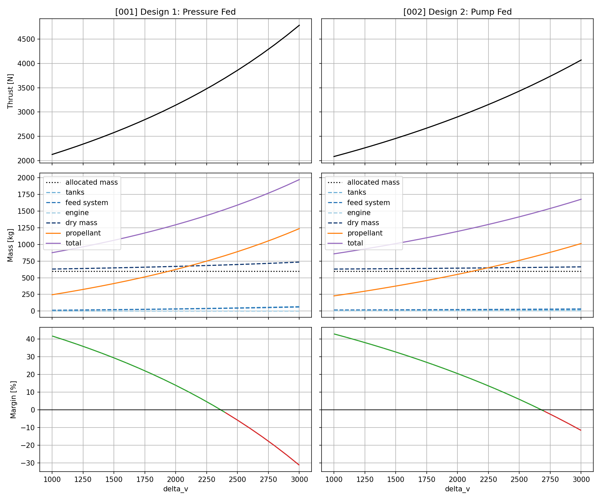

# Result Summary

## Problem Statement
Size a lunar descent propulsion system two ways, pressure-fed and pump-fed, and compare propellant mass and margin. Then sweep one parameter (not Isp) to show its sensitivity.

**Specifations**
- Delta-V: 2,000 m/s
- Dry mass, excluding propulsion: 600 kg
- Maximum initial mass: 1,500 kg
- Thrust-to-weight at ignition: >= 1.5
- Propellant density: 1,000 kg/m3, single fluid
- Tank mass: proportional to tank pressure and propellant mass

**Case 1: Pressure-fed**
- Tank pressure: 25 bar
- Engine inlet pressure: 20 bar
- Isp: 310 s
- Pressurant mass: 0.002 /bar x tank pressure x propellant mass

**Case 2: Pump-fed**
- Tank pressure: 10 bar
- Engine inlet pressure: 40 bar
- Isp: 330 s
- Pump mass: 0.008 kg/N x thrust

> **NOTE** Assumption: engine mass is 0.2 kg/bar x engine inlet pressure, it was not provided.

**Outputs**
- Required propellant mass for each case
- Margin against the requirement for each case
- Sensitivity of both cases to one chosen parameter

## Comparison Results Results

**Inputs:**
| Requirement | Value |
|---|---:|
| Delta-V [m/s] | 2000.0 |
| Thrust-to-weight [-] | 1.50 |
| Dry mass [kg] | 600.0 |
| Maximum mass [kg] | 1500.0 |

Config File: [pressure_vs_pump.json](../src/configs/comparative_study/pressure_vs_pump.json)
```
python3 -m src.main compare pressure_vs_pump
```

**Outputs:**

| | Case 1: Pressure-fed | Case 2: Pump-fed |
|---|---:|---:|
| Propellant mass [kg] | 623.28 | 550.21 |
| Propulsion system mass [kg] | 69.70 | 43.35 |
| &nbsp;&nbsp;Tank mass [kg] | 34.53 | 12.14 |
| &nbsp;&nbsp;Feed system mass [kg] | 31.16 | 23.20 |
| &nbsp;&nbsp;Engine mass [kg] | 4.00 | 8.00 |
| Dry mass [kg] | 669.70 | 643.35 |
| Total mass [kg] | 1292.98 | 1193.56 |
| Thrust [N] | 3141.9 | 2900.3 |
| Margin [%] | 13.8 | 20.4 |

## Sensitivity Analysis

**Inputs:**
| Requirement | Value |
|---|---:|
| Delta-V [m/s] | 2000.0 |
| Thrust-to-weight [-] | 1.50 |
| Dry mass [kg] | 600.0 |
| Maximum mass [kg] | 1500.0 |

Config File: [sweep_config.json](../src/configs/sensitivity_study/sweep_config.json)
```
python3 -m src.main sweep sweep_config
```

**Outputs:**


