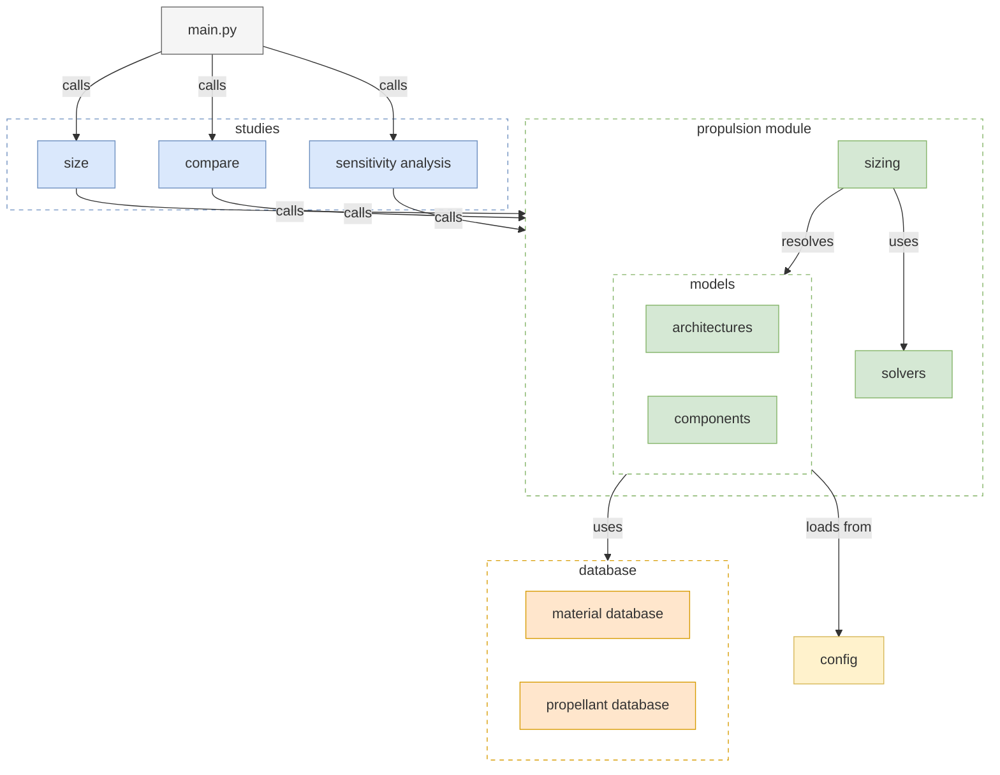
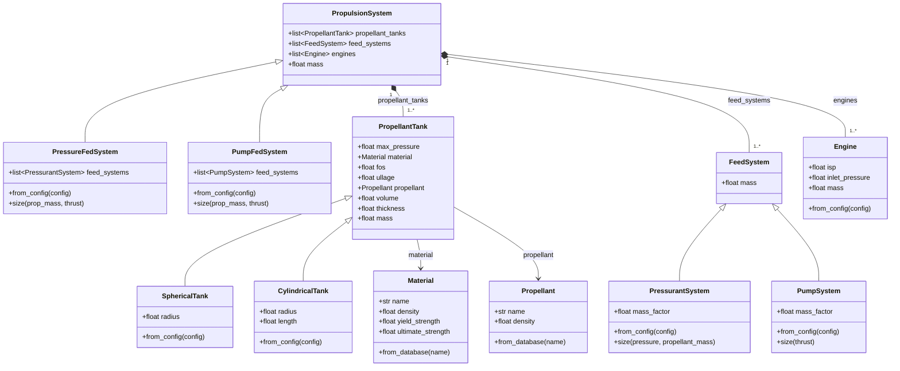

# Overview

## Directory Structure
```text
ispc-intrvw-prop-sizing
├── docs/                       # Documentation 
├── src/                        # Source Code          
└── tests/                      # Test Cases
```

## Architecture
```text
src
├── configs/                    # JSON Config files
│   ├── comparative_study/          # Cases sized side by side
│   ├── sensitivity_study/          # Parameter sweeps
│   └── sizing_study/               # Single designs
├── constants/                  # Default factors, asset paths, universal constants
├── database/                   # Material and propellant tables
├── propulsion_module/          # Propulsion Module
│   ├── models/                 # Data classes
│   │   ├── architectures/      
│   │   ├── components/         
│   │   │   └── tanks/          
│   │   ├── materials/          
│   │   └── propellants/        
│   ├── sizing/                 # Single Propulsion module solution logic
│   └── solvers/                # Equaqtion solvers
├── studies/                    # sizing, compariosn and sensitivity loic
├── utils/                      # Unit conversion
└── main.py/                    # Entry Point
```

## Components


## Models

